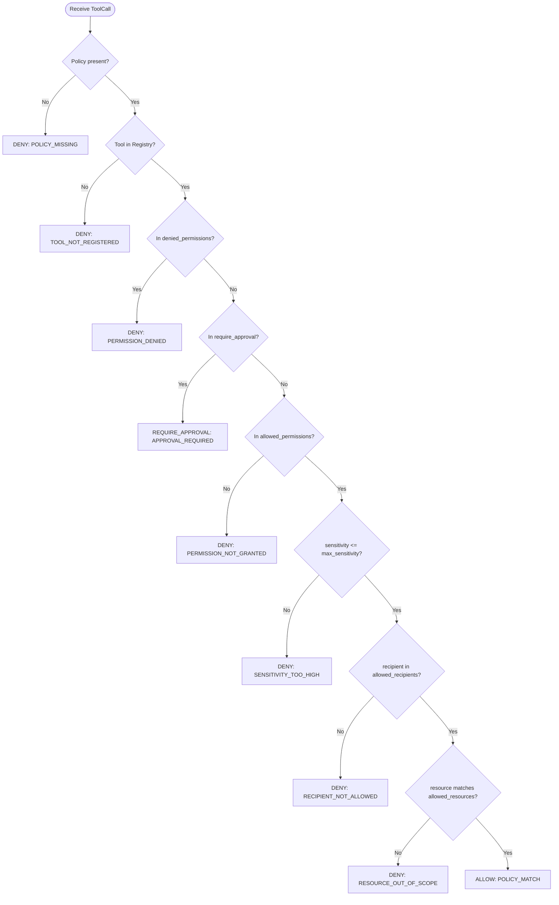

# SYSTEM ARCHITECTURE — INTENTLOCK (Project B)

## 1. High-Level Architecture Overview

INTENTLOCK operates as an inline security enforcement layer between an AI Agent application and external execution environments.

```
                      +---------------------------------------+
                      |         Host AI Application           |
                      |   (LangChain / Custom ReAct Agent)    |
                      +---------------------------------------+
                                          |
                                          | Proposed Tool Call
                                          v
+===================================================================================+
|                              INTENTLOCK SDK GATEWAY                               |
|                                                                                   |
|   +-------------------+      +-------------------+      +---------------------+   |
|   |   Tool Registry   |      |   Policy Engine   |      |     Risk Engine     |   |
|   |  (Schemas, Perms) |      | (Deterministic)   |      |  (Explainable Risk) |   |
|   +-------------------+      +-------------------+      +---------------------+   |
|             |                          |                          |               |
|             +--------------------------+--------------------------+               |
|                                        |                                          |
|                                        v                                          |
|                         +-----------------------------+                           |
|                         |  Decision Pipeline          |                           |
|                         |  (ALLOW / DENY / APPROVAL)  |                           |
|                         +-----------------------------+                           |
|                                        |                                          |
|                   +--------------------+--------------------+                     |
|                   |                    |                    |                     |
|                [ ALLOW ]            [ DENY ]      [ REQUIRE_APPROVAL ]            |
|                   |                    |                    |                     |
|                   v                    v                    v                     |
|          +-----------------+    +-------------+   +-------------------+           |
|          | Execution Guard |    | Block Call  |   | Approval Service  |           |
|          | (Invoke Handler)|    | (Raise Err) |   | (Hold for Token)  |           |
|          +-----------------+    +-------------+   +-------------------+           |
|                   |                    |                    |                     |
|                   +--------------------+--------------------+                     |
|                                        |                                          |
|                                        v                                          |
|                             +--------------------+                                |
|                             |    Audit Engine    |                                |
|                             |  (Redacted Trail)  |                                |
|                             +--------------------+                                |
+========================================|==========================================+
                                         |
                                         v
                         +-------------------------------+
                         |   Backend Storage & API       |
                         |  (PostgreSQL / FastAPI REST)  |
                         +-------------------------------+
                                         |
                                         v
                         +-------------------------------+
                         |   Security Dashboard (Next.js)|
                         +-------------------------------+
```

---

## 2. Trust Boundaries

| Boundary | Trust Level | Description / Constraints |
|:---|:---|:---|
| **LLM Output / Reasoning** | **UNTRUSTED** | Model outputs, tool arguments, and indirect prompts may be manipulated via prompt injection. Treated strictly as raw data requests. |
| **User Request Context** | **ADVISORY** | Original natural language user prompt provides context for the intent engine, but does NOT constitute authorization. |
| **Developer Policy Definition** | **TRUSTED** | Policies declared by the application owner or administrator in code, config files, or authenticated backend endpoints. |
| **INTENTLOCK Policy Engine** | **TRUSTED** | Pure, deterministic validation logic that evaluates inputs against approved policy rules without external network or LLM dependencies. |
| **Tool Execution Boundary** | **ENFORCED** | The actual function pointer or handler is encapsulated inside the SDK registry. Agents cannot directly invoke tools without passing the gateway. |
| **Audit Log Store** | **INTEGRITY-CRITICAL** | Must record decisions faithfully and fail closed if persistence cannot be guaranteed. |

---

## 3. Tool Call Lifecycle & Execution Flow

### 3.1 Scenario: Immediate ALLOW
1. Agent generates tool invocation: `tool_name="read_email", arguments={"limit": 5}`.
2. `SecureAgent.execute()` wraps call into a typed `ToolCall` and computes SHA-256 canonical hash.
3. Gateway requests `RiskEngine.assess()`, calculating dynamic risk signals.
4. Gateway invokes `PolicyEngine.evaluate()`.
5. Policy matches `allowed_permissions` without violation. Verdict: `ALLOW`.
6. Gateway retrieves internal handler from `ToolRegistry` and executes it with validated parameters.
7. Result is captured; `AuditService.record()` logs successful execution.
8. Output is returned to the agent.

### 3.2 Scenario: Explicit DENY
1. Agent attempts unauthorized action: `tool_name="delete_email", arguments={"id": "all"}`.
2. Gateway inspects policy: `delete_email` is in `denied_permissions` (or absent from `allowed_permissions`).
3. Verdict: `DENY`. Reason: `PERMISSION_DENIED` or `PERMISSION_NOT_GRANTED`.
4. Tool handler is **never** invoked.
5. `AuditService.record()` logs the unauthorized attempt.
6. Gateway raises `PermissionDeniedError` to caller.

### 3.3 Scenario: REQUIRE_APPROVAL (Human-in-the-Loop)
1. Agent proposes high-impact tool: `tool_name="export_user_data", arguments={"format": "csv"}`.
2. Policy identifies `export_user_data` in `require_approval_permissions`. Verdict: `REQUIRE_APPROVAL`.
3. Gateway invokes `ApprovalService.create_request()`, storing:
   - Unique `approval_id`
   - Canonical `action_hash = SHA256(canonical_payload)`
   - UTC `expires_at` (now + 300 seconds)
4. Gateway logs pending audit event and raises `ApprovalRequiredError(approval_id, action_hash)`.
5. Human supervisor reviews the action via Dashboard or CLI and calls `approve(approval_id)`.
6. Agent (or workflow orchestrator) calls `agent.execute_with_approval(tool_call, approval_id)`.
7. Gateway validates:
   - Approval exists and status is `APPROVED`.
   - Expiration timestamp has not passed.
   - `ApprovalRequest.consumed` is `False`.
   - Action payload hash precisely matches the approval token.
8. Approval is marked `consumed = True`.
9. Tool handler executes, audit log records completed approval, and result returns.

---

## 4. Policy Engine Evaluation Order



---

## 5. Module Structure and Separation

```
INTENTLOCK_SDK/
├── sdk/python/
│   ├── pyproject.toml
│   └── src/intentlock/
│       ├── __init__.py           # Public exports
│       ├── models.py             # Pydantic v2 schemas
│       ├── exceptions.py         # Structured security exceptions
│       ├── logger.py             # Redacting JSON logger
│       ├── registry.py           # Tool registration & schemas
│       ├── policy_engine.py      # Deterministic evaluation logic
│       ├── risk_engine.py        # Explainable risk scorer
│       ├── approval.py           # Single-use approval workflow
│       ├── audit.py              # Audit recording & query service
│       ├── gateway.py            # Runtime enforcement interceptor
│       └── agent.py              # Developer-facing SecureAgent facade
```

